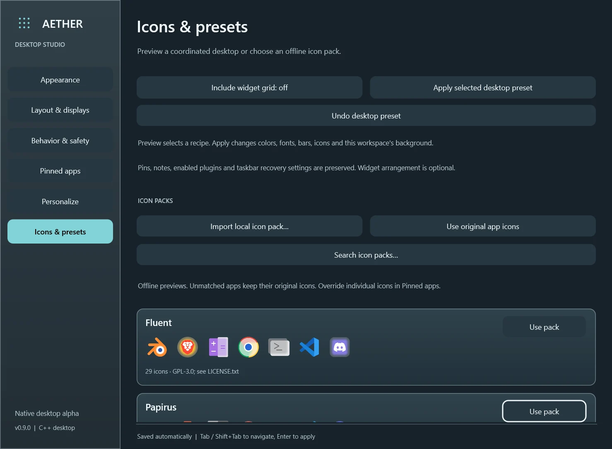

# Aether UI

**A customizable native desktop experience for Windows.** Ubuntu-inspired navigation, a fullscreen window overview, multi-monitor panels, and a personal desktop studio—built with C++20, Win32, Direct2D and DirectWrite.

> Active development / v0.9 preview. Source is available; this is not a finished production release. See [validation and known limitations](docs/TESTING.md).



## Make the desktop your own

- **Activities:** fullscreen window overview, large previews, monitor filters, app grouping and close controls.
- **Workspaces:** drag-and-drop window organization, renaming, reordering and per-workspace wallpapers on supported Windows versions.
- **Desktop Studio:** separate fonts for UI parts, wallpaper-derived colors, draggable top-bar modules, independent panel/dock styles and six coordinated desktop presets with Apply/Undo.
- **Widgets:** clock, media, notes, resources and optional weather, with locked layouts, grid snapping and explicit resize controls.
- **Icon packs:** eight curated offline packs, 219 mapped PNG assets, native browsing, local import, per-app overrides and native-icon fallback.
- **Backgrounds:** local still images and restrained native animation, including the Woodland Zen scene. Reduced motion, battery and coverage rules pause animation.
- **Recovery:** optional native taskbar hiding with a separate recovery process, emergency restore, and crash/hang recovery. Explorer stays running; no Windows system files are replaced.


*AI-generated still artwork with native pond/mist effects at runtime; this image is not an animation or a desktop screenshot.*

## Build on Windows

Install Visual Studio 2022 with **Desktop development with C++**, Windows SDK and CMake tools. From a developer shell:

```powershell
cmake -S . -B build-v03 -G "Visual Studio 17 2022" -A x64 -DBUILD_TESTING=ON
cmake --build build-v03 --config Release --parallel 4
```

Close an existing Aether instance before building/running another copy. Run `Start.cmd` after building, or launch `build-v03/Release/AetherUI.exe`. A fresh local profile is created; personal development profiles are not distributed. No Windows login startup entry is installed.

**Ctrl+Alt+E** opens Studio. **Ctrl+Alt+F12** restores the native desktop and disables hiding. Normal Quit restores Windows while retaining the preference for the next launch. Keep the recovery shortcut available before enabling taskbar hiding.

For core-only Linux builds, use standard CMake configure/build/CTest commands. Linux builds the portable model/tests, not the Windows desktop UI.

## Validation

The last local Windows source validation passed **50 non-input suites per configuration**, **207 native recovery assertions per configuration**, and **six real preset Apply/Undo cycles in Release and Debug**. Four final input-sensitive suites and extended pointer/gesture certification remain incomplete. GitHub Actions builds Windows targets and runs a smaller headless-safe test set; it does not certify interactive desktop recovery.

Known issues include brief native taskbar exposure during some layout transitions before automatic re-hide, unfinished extended pointer validation, and unsupported workspace integration on some Windows versions. Read [TESTING.md](docs/TESTING.md) before treating this preview as a replacement desktop.

## Project

Created by [Timothy Jankowski](https://bcts1100.github.io/Portfolio/projects/aether-ui.html), using an iterative design and AI-assisted development workflow. Inspired by Ubuntu/GNOME desktop interaction patterns and the customization demonstrated by [Seelen UI](https://github.com/eythaann/Seelen-UI). Aether uses its own native C++ implementation.

[Controls](docs/DESKTOP_POLISH_USAGE.md) · [Validation](docs/TESTING.md) · [Third-party notices](THIRD_PARTY_NOTICES.md)

No project-wide source license has been selected. Bundled third-party assets retain their own license terms and attribution.
